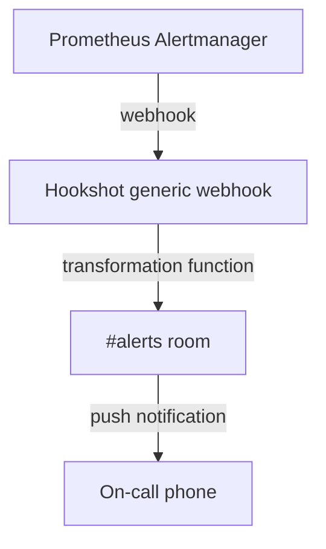

# Automation & Workflows

Ways to get events into Matrix rooms and act on them from chat. The commands shown come from each tool's current source or README (as of 2026-10).

:::warning Bot credentials
Every bot or script here holds a Matrix access token, and some also hold GitHub, GitLab or Jira credentials. Use a dedicated bot account with only the power level it needs, keep tokens in a secrets store or a file readable only by the bot, and rotate them if they leak.
:::

## Notification pipelines

### Shell scripts and cron

[matrix-commander](https://github.com/8go/matrix-commander) is the simplest way to post from a script. See [Power Tools](./power-tools#matrix-commander).

```bash title="/usr/local/bin/disk-check.sh"
#!/bin/sh
usage=$(df / --output=pcent | tail -1 | tr -d ' %')
if [ "$usage" -gt 90 ]; then
  matrix-commander -m "Disk usage on $(hostname) is ${usage}%" -r '!alerts:example.org'
fi
```

```cron title="/etc/cron.d/disk-check"
*/5 * * * * matrixbot /usr/local/bin/disk-check.sh
```

Run it as the user whose matrix-commander credentials are set up (`matrixbot` here), not as root.

### ntfy topics

The third-party maubot plugin [maubot-ntfy](https://gitlab.com/999eagle/maubot-ntfy) subscribes a room to [ntfy](https://ntfy.sh) topics. Anything published to the topic appears in the room. Topics on the public ntfy.sh server can be read and written by anyone who knows the name, so use a self-hosted ntfy server or access-controlled topics for anything sensitive.

### CI/CD

- **GitHub Actions**: use [Cadair/matrix-notify-action](https://github.com/Cadair/matrix-notify-action) pinned to `@v3`. Example in [Power Tools](./power-tools#github-actions).
- **GitLab CI**: a `curl` `PUT` to the send-message endpoint. Example in [Power Tools](./power-tools#gitlab-ci).
- **Hookshot**: connect a repository and the room receives push, issue, PR and release events:

```
!hookshot github repo https://github.com/owner/repo
!hookshot gitlab project https://gitlab.example.com/group/project
```

Both need the full URL, and you must first log in to GitHub or GitLab through Hookshot.

### RSS and Atom feeds

```
!hookshot feed https://blog.example.com/feed.xml
!hookshot feed list
!hookshot feed remove https://blog.example.com/feed.xml
```

The maubot [rss](https://github.com/maubot/rss) plugin does the same if you run maubot instead.

---

## Chat-ops

### GitHub

**Hookshot** (prefix `!gh`, in a room connected to a repository):

```
!gh create "Bug: login broken"
!gh assign 123 octocat
!gh close 123
!gh workflow run deploy.yml env=prod
```

**maubot github plugin** (prefix `!github` or `!gh`):

```
!github login
!github create owner/repo Bug: login broken
!github webhook add owner/repo
```

For `create`, the first line is the issue title and any further lines become the body.

Neither tool can list, review or merge pull requests from chat.

### GitLab (Hookshot, prefix `!gl`)

```
!gl create "Feature request"
!gl create-confidential "Security report"
!gl close 42
```

### Jira (Hookshot, prefix `!jira`)

```
!jira create Bug "Login page crashes"
!jira assign PROJ-123 john
!jira issue-types
```

Hookshot has no Jira transition command.

---

## Reminders

The maubot [reminder](https://github.com/maubot/reminder) plugin sets one-off reminders:

```
!remind 30 minutes check the build
!remind tomorrow at 9:00 standup meeting
!remind friday at 15:00 review PR
!remind list
!remind tz Europe/Berlin
```

Other people subscribe to a reminder by reacting 👍 to it. After a reminder fires, `!reminder again <date>` reschedules it. The plugin has no recurring reminders. For those, use cron with matrix-commander, or the third-party [reminder-agenda](https://github.com/MxMarx/reminder) plugin (last updated 2023).

```cron title="/etc/cron.d/standup"
45 8 * * 1-5 matrixbot matrix-commander -m "Standup in 15 minutes" -r '!team:example.org'
```

---

## Generic webhooks with Hookshot

### Create a webhook

```
!hookshot webhook alerts
```

Hookshot replies with a URL built from the `generic.urlPrefix` in its config. POST JSON to it:

```bash
curl -X POST "https://hooks.example.org/webhook/<id-from-hookshot>" \
  -H "Content-Type: application/json" \
  -d '{"text": "Deployment complete"}'
```

A `text` key becomes the message body (Markdown is rendered). An `html` key sets the formatted body. Without `text`, Hookshot posts the whole payload.

### Transformation functions

To turn arbitrary JSON into a message, Hookshot can run a small JavaScript function. This is **off by default**: the admin must set `generic.allowJsTransformationFunctions: true`. The script lives in the room's `uk.half-shot.matrix-hookshot.generic.hook` state event, under `transformationFunction`. It reads `data` and must assign `result`:

```javascript
if (data.status === undefined) {
  result = { version: "v2", empty: true };
} else {
  result = {
    version: "v2",
    plain: `**${data.service}** is ${data.status}`,
    msgtype: data.status === "down" ? "m.text" : "m.notice",
  };
}
```

Anyone who can edit room state can change the script, so restrict that power level. Reference: [Hookshot webhooks](https://matrix-org.github.io/matrix-hookshot/latest/setup/webhooks.html).

### Common sources

| Service | How |
|---------|-----|
| Uptime Kuma | Has a built-in Matrix notification type |
| Healthchecks.io | Has a built-in Matrix integration |
| Grafana alerting | Webhook contact point → Hookshot URL, plus a transformation function |
| Prometheus Alertmanager | Webhook receiver → Hookshot with a transformation function, or a dedicated Matrix receiver |
| Home Assistant | Its Matrix integration, or a shell command calling matrix-commander |

---

## Voice transcription and LLMs

- [gladia_transcribebot](https://github.com/conan747/gladia_transcribebot) (third-party maubot plugin, active 2026-10) transcribes voice messages using the Gladia API. Audio is sent to that service.
- [maubot-llm](https://github.com/brokensandals/maubot-llm) (third-party, last updated 2024-05) chats with LLMs on OpenAI-compatible servers, including local ones. Check its README for commands and configuration.

In encrypted rooms, these bots send the decrypted content to an outside service. Tell the room before adding one.

---

## Support desks

[maubot/supportportal](https://github.com/maubot/supportportal) lets users start a support case by inviting the bot. Agents then pick cases up in a management room. It has had no updates since 2020, so treat it as unmaintained.

---

## Welcome messages

Neither Draupnir nor Mjolnir sends welcome messages. A few lines of [matrix-nio](https://github.com/matrix-nio/matrix-nio) (0.26.0) will do it:

```python
from nio import AsyncClient, RoomMemberEvent

client = AsyncClient("https://matrix.example.org", "@welcomebot:example.org")
client.access_token = "..."  # load from a secrets file

async def on_member(room, event: RoomMemberEvent):
    if event.membership == "join" and event.prev_membership != "join" \
            and event.state_key != client.user_id:
        await client.room_send(
            room.room_id, "m.room.message",
            {"msgtype": "m.notice", "body": f"Welcome {event.state_key}! Please read the pinned rules."},
        )

client.add_event_callback(on_member, RoomMemberEvent)
# await client.sync_forever(timeout=30000)
```

Skip the events from the first sync, or the bot will greet everyone already in the room. See [Building Bots](../bots/building-bots).

---

## LDAP and Azure AD room membership

[SAPUCC/inviterbot](https://github.com/SAPUCC/inviterbot) (maubot plugin, active 2026-09) syncs users from LDAP or Azure AD into Matrix rooms, including power levels. Its config keys, such as `idp_type`, the `ldap` section (`host`, `port`, `bind_dn`, `base_dn_users`, `base_dn_groups`) and `administration_room`, are documented in its [`base-config.yaml`](https://github.com/SAPUCC/inviterbot/blob/main/base-config.yaml). Copy that file rather than writing one from scratch.

---

## Example: alert pipeline



## Checklist

1. Create dedicated rooms: alerts, deploys, feeds.
2. Run bots on dedicated accounts with the minimum power level they need.
3. Store tokens outside the repo and shell history.
4. Pin CI actions to tags or SHAs.
5. Turn on push notifications for the critical rooms only.
