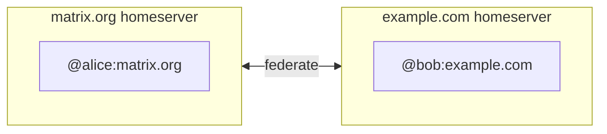

# Core Concepts

These concepts explain how Matrix behaves, and why clients and servers do what they do.

## The Matrix network

Matrix is a **federated network** of homeservers. Think of email:
- Your email address is tied to a provider (Gmail, Outlook, etc.)
- But you can email anyone on any provider
- Matrix works the same way for chat rooms



## Matrix IDs

Your Matrix ID (MXID) identifies you across the network:

```
@username:homeserver.org
│    │          │
│    │          └── The server where your account lives
│    └── Your chosen username
└── @ symbol indicates this is a user
```

Other identifiers:
- `#alias:server.org`: a room alias, human-readable and changeable
- `!L58ME6ufiP49v97UIOBIpvWKEgj4912JmECPuDzlvCI`: a room ID, the permanent internal identifier. In [room version 12](https://spec.matrix.org/v1.19/rooms/v12/) (the default in Synapse since 1.162) the room ID is a hash of the room's creation event and has no server name. Rooms created with older versions have IDs like `!abcd1234:server.org`.
- `$Rqnc-F-dvnEYJTyHq_iKxU2bZ1CI92-kuZq3a5lr5Zg`: an event ID. Since room version 3, event IDs are hashes with no server name.

The old `+community:server.org` "groups" never entered the spec and were removed; Spaces replaced them.

## Rooms

Rooms are the core unit of communication in Matrix.

### Room properties

| Property | Description |
|----------|-------------|
| **Room ID** | Permanent identifier, such as `!L58ME6ufiP49v97UIOBIpvWKEgj4912JmECPuDzlvCI` |
| **Aliases** | Human-readable names like `#matrix:matrix.org` |
| **State** | Room settings (name, topic, permissions, etc.) |
| **Timeline** | The ordered list of events (messages) |

### Room types

- **Direct messages (DMs)**: 1:1 or small group conversations
- **Private rooms**: invite-only group chats
- **Public rooms**: anyone can join, often listed in room directories
- **Spaces**: rooms that group other rooms (like Discord servers)

## Events

Everything in Matrix is an **event**. Events are JSON objects:

```json
{
  "type": "m.room.message",
  "sender": "@alice:matrix.org",
  "content": {
    "msgtype": "m.text",
    "body": "Hello, Matrix!"
  },
  "origin_server_ts": 1234567890123,
  "event_id": "$Rqnc-F-dvnEYJTyHq_iKxU2bZ1CI92-kuZq3a5lr5Zg"
}
```

### Event types

| Type | Description |
|------|-------------|
| `m.room.message` | Text, images, files, etc. |
| `m.room.member` | Join, leave, invite, ban |
| `m.room.name` | Room name changes |
| `m.room.topic` | Room topic changes |
| `m.room.power_levels` | Permission changes |
| `m.room.encryption` | Turns on end-to-end encryption |

## Federation

Federation is how homeservers communicate:

1. **Alice** on `matrix.org` sends a message to a room
2. The room has members from `example.com`
3. `matrix.org` sends the event to `example.com`
4. **Bob** on `example.com` receives the message

:::tip
When you join a room, your homeserver keeps its own copy of the room. This means:
- Messages are stored on every participating homeserver
- If one server goes down, the others carry on
- **Leaving a room does not delete your server's copy.** "Forgetting" a room only hides it from you. In Synapse, a room's data is purged once every local user has forgotten it only if the admin sets `forgotten_room_retention_period` (`forget_rooms_on_leave` makes leaving count as forgetting). Admins can also use message retention policies or the [Delete Room admin API](https://element-hq.github.io/synapse/latest/admin_api/rooms.html#delete-room-api). Other servers in the room keep their own copies.
:::

## End-to-end encryption (E2EE)

Element and Element X encrypt DMs and private rooms by default. Two protocols are involved:

- **Megolm** encrypts room messages, in DMs and group rooms alike. Each message is encrypted once per Megolm session, not once per recipient.
- **Olm** encrypts the device-to-device ("to-device") channel used to hand each recipient device the Megolm session key.

### How it works

1. Each device has its own identity keys.
2. The sender encrypts a message with the current Megolm session.
3. The session key goes to each recipient device over Olm.
4. **Cross-signing** lets you mark your own devices as yours, and other users as verified.
5. **Key backup**, unlocked with your recovery key, stores session keys on the server (encrypted) so a new device can read old messages.

### Verification

To confirm you are talking to the right person or device:

1. **Emoji comparison**: compare the same emoji on both screens
2. **QR code**: scan a code shown on the other device
3. **Cross-signing**: once your devices are verified, other people's clients trust them through your identity

## Power levels

Rooms grant permissions with numeric "power levels". By convention, users have 0, moderators 50 and admins 100. The table shows Synapse's defaults for new rooms:

| Level | Typical role | Capabilities |
|-------|-------------|--------------|
| 0 | Default | Send messages |
| 50 | Moderator | Kick and ban users, delete messages, change the room name, topic, avatar and address |
| 100 | Admin | Change permissions, history visibility, encryption and server ACLs |
| ∞ | Room creator(s), room version 12+ | Everything; cannot be demoted |

In [room version 12](https://spec.matrix.org/v1.19/rooms/v12/), the user who created the room (plus any `additional_creators`) has an infinitely high power level. Creators are not listed in `m.room.power_levels` and cannot be changed after creation. New v12 rooms also restrict who can upgrade the room (send `m.room.tombstone`); Synapse sets this to 150, above the other admin actions. In older room versions, the creator simply starts at 100.

:::info
The thresholds are customizable. A room can require any level for each action.
:::

## Spaces

Spaces are Matrix's answer to Discord servers or Slack workspaces:

- **Hierarchical**: spaces can contain rooms and other spaces
- **Flexible**: a room can belong to several spaces
- **Access control**: the `restricted` join rule (room version 8+) lets members of chosen spaces join a room without an invite. Membership is not inherited automatically.

```
Space: "My Community"
├── #general
├── #random
├── Space: "Development"
│   ├── #frontend
│   └── #backend
└── Space: "Social"
    ├── #gaming
    └── #music
```

## Next steps

- [Quick Start](./quick-start): get your first Matrix account
- [Clients](../clients/overview): choose a Matrix client
- [Specification](../specification/overview): the protocol in depth

---

*Next: [Quick Start](./quick-start) →*
