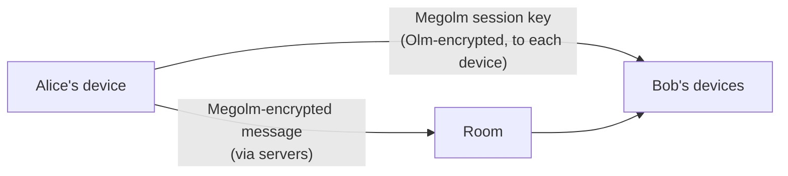

# Security & Privacy

This page explains what Matrix encryption protects, what it does not, and what users and admins should do about it. The normative reference is the [end-to-end encryption section of the spec](https://spec.matrix.org/v1.19/client-server-api/#end-to-end-encryption).

:::info Recent changes (2024–2026)
- **libolm → vodozemac**: the C library libolm was [deprecated in August 2024](https://matrix.org/blog/2024/08/libolm-deprecation/) after timing side-channel reports. Current clients use vodozemac (Rust) through matrix-rust-sdk or its bindings.
- **"Invisible crypto"** (MSC4153, spec v1.18): clients SHOULD NOT send room keys to devices that their owner has not cross-signed, and SHOULD NOT show messages from such devices.
- **Encrypted history sharing** (MSC4268, spec v1.19): when you invite someone to an encrypted room, your client can send them the keys for earlier messages, subject to the room's history setting. Element Web has done this by default since 1.12.18 (2026-05).
- **OAuth 2.0 login** (spec v1.15+): servers using the Matrix Authentication Service (MAS), including matrix.org, handle passwords and sessions in a separate account portal.
- **Room version 12** (spec v1.16, the Synapse default since 1.162): fixes the two vulnerabilities disclosed in [Project Hydra](https://matrix.org/blog/2025/08/project-hydra-improving-state-res/) (CVE-2025-49090, state resolution; CVE-2025-54315, room IDs) and gives room creators an unremovable top power level.
:::

## End-to-end encryption (E2EE)

### How it works

Matrix uses two protocols, both implemented in [vodozemac](https://github.com/matrix-org/vodozemac):

- **Megolm** encrypts room messages, in DMs and group rooms alike. A sender encrypts each message once with its current Megolm session.
- **Olm** is a Double Ratchet channel between two devices. It is used to send each recipient device the Megolm session key, and for other device-to-device secrets.



### What is encrypted

In an encrypted room, the server and other participating servers see an event of type `m.room.encrypted`. Inside it, only the recipients can read the payload.

| Encrypted (payload) | Not encrypted (visible to servers) |
|---------------------|------------------------------------|
| Message text and formatting | Outer event type (`m.room.encrypted`) |
| Message type (`msgtype`: text, image, file…) | Sender, room, timestamp |
| Attachments (files are encrypted before upload) | All room state: name, topic, avatar, membership, power levels, join rules |
| The new text of an edit; the content of a reply | The `m.relates_to` relation: which event a reply, edit, thread message or reaction points to ([spec](https://spec.matrix.org/v1.19/client-server-api/#forming-relationships-between-events)) |
| | Read receipts and typing notifications |
| | Your display name and avatar |
| | Reactions, including the emoji: it sits in `m.relates_to`, which stays in cleartext |

Element Web has an experimental Labs option to encrypt some state events (MSC4362), but this is not in the spec as of v1.19.

### Device trust

Under the spec's current recommended behaviour (v1.18, MSC4153):

| Device status | What happens |
|---------------|--------------|
| **Cross-signed by its owner** | Trusted. Receives room keys. Its messages are shown normally. |
| **Not cross-signed** | Not trusted. Clients SHOULD NOT send it room keys or secrets, and SHOULD NOT show its messages. |

Cross-signing works at two levels:

1. **Your own devices**: confirm each new device from an existing one (QR code or emoji) or with your recovery key. Clients following the recommendation will not send keys to an unconfirmed device.
2. **Other people**: verifying someone (comparing emoji in person or over a call) confirms their cross-signing identity. If a verified person's identity later changes, your client shows a prominent warning. If you never verified them, it still shows a notice when their identity changes.

You no longer verify or block other people's devices one by one.

:::info Coming next
The Foundation [said in November 2025](https://matrix.org/blog/2025/11/exclude-insecure-devices/) that Element would start excluding non-cross-signed devices by default in April 2026. Element's [device verification help page](https://docs.element.io/latest/element-support/device-verification/how-to-verify-devices/) now says the rollout is postponed, with a month's notice to come. Until then, Element sends keys to unverified devices by default; Element Web 1.12.32 has an opt-in Labs option, **Exclude insecure devices when sending/receiving messages**. Verify all your devices now so nothing breaks when it ships.
:::

### Key backup and recovery

Key backup stores your Megolm session keys on your homeserver, encrypted with a key only you hold. It lets a new device read old messages.

- **Element Web / Desktop**: Settings → **Encryption** → Recovery, and make sure **Key storage** is on.
- **Element X**: Settings → **Encryption** → Recovery.

New setups produce a single **recovery key**. Older setups may have a "Security Phrase"; Element still accepts it for restoring, but no longer creates one.

:::warning
If you lose your recovery key **and** every signed-in device, you must reset your digital identity (Settings → **Encryption** → reset). You keep your account, contacts and rooms, but you lose any encrypted history that was stored only in key backup.
:::

### Getting keys for older messages

When a device cannot decrypt a message, the main remedies are:

1. **Key backup**: enter your recovery key.
2. **Verification**: verify the device from another signed-in device; the client then shares secrets, including the backup key.
3. **History sharing on invite** (spec v1.19): clients that support it (Element Web since 1.12.18) send an encrypted key bundle when they invite someone, so new members can read messages sent while the history setting was `shared` or `world_readable`.

The spec also defines **key requests** (`m.room_key_request`). Clients answer them only in limited cases, mainly for the same user's verified devices, so treat them as a fallback rather than a way to recover history.

## Privacy considerations

### Metadata

Even with E2EE, a lot of metadata is visible:

| What | Visible to |
|------|------------|
| Who is in which room | Your homeserver, every homeserver with members in the room, room members |
| When and by whom each message was sent | Every participating homeserver |
| Room names, topics and avatars | Every participating homeserver and room members |
| Read receipts and typing | Every participating homeserver and room members |
| Contact lookups by email or phone | The identity server your client uses (Element at app.element.io defaults to `vector.im`) |

### Choosing a homeserver

Your homeserver sees the most metadata: your IP address, the rooms you join, your devices and your contacts. Choose one whose operator you trust:

| Homeserver | Consider |
|------------|----------|
| Self-hosted | You control the data, and you carry the maintenance and security work |
| Public provider | Read its privacy policy, terms and logging practice |
| matrix.org | Large public server run by the Foundation; see its [terms](https://matrix.org/legal/terms-and-conditions/) |

### IP addresses

- **Your homeserver** sees your IP address on every request.
- **Other homeservers** normally see only your homeserver's address, not yours.
- **Calls**: TURN servers and LiveKit/Element Call media servers see your IP address, and 1:1 calls may connect peer-to-peer.
- **Media and link previews** are fetched through your homeserver, which hides your IP from the remote site. Spec v1.11 added authenticated media downloads, and Synapse refuses unauthenticated downloads of new media by default (`enable_authenticated_media`).

Use a VPN or Tor if you need to hide your IP from your own homeserver.

## Room security

### Join rules and history are separate settings

Who can join (join rule) and who can read history (history visibility) are set independently.

| Join rule | Meaning |
|-----------|---------|
| `invite` | Invite only |
| `knock` | Users can ask to join |
| `restricted` | Members of chosen spaces can join |
| `public` | Anyone can join |

### History visibility

| Value | Who can read |
|-------|-------------|
| `world_readable` | Anyone, even without joining |
| `shared` (default) | Members can read all history, including messages sent before they joined |
| `invited` | Members can read from the point they were invited |
| `joined` | Members can read from the point they joined |

The setting applies when a message is sent. Changing it later does not hide or reveal earlier messages ([spec](https://spec.matrix.org/v1.19/client-server-api/#room-history-visibility)).

### Server ACLs {#server-acls}

A server ACL blocks whole servers from a room:

```json
{
  "type": "m.room.server_acl",
  "state_key": "",
  "content": {
    "allow": ["*"],
    "deny": ["evil.example.com", "*.evil.example.com"],
    "allow_ip_literals": false
  }
}
```

Element has no settings screen for ACLs. Send the event with `/devtools` → **Send custom state event**, or let a moderation bot such as Draupnir manage it. Keep your own server allowed, or you lock yourself out.

## Good practice

### Users

1. **Set up recovery** and store the recovery key in a password manager.
2. **Verify every device you sign in on**, straight away.
3. **Verify the people you talk to** about sensitive things, in person or over a call.
4. **Review your sessions** (Element: Settings → **Devices**) and sign out old ones.
5. **Use a strong, unique password**, or single sign-on with multi-factor authentication if your server offers it.
6. **Be careful with invites** from people you do not know.

### Admins

:::warning
Open registration without a token, CAPTCHA or email check invites spam accounts that can get your server blocked across the federation.
:::

1. **Control registration.** In Synapse, either keep `enable_registration: false` and create accounts yourself, or require a token or CAPTCHA:

   ```yaml
   # homeserver.yaml (Synapse 1.163)
   enable_registration: true
   registration_requires_token: true
   ```

   `enable_registration_captcha` adds a reCAPTCHA check. Never set `enable_registration_without_verification`. On servers that use the Matrix Authentication Service, registration is configured in MAS instead. See the [Synapse configuration reference](https://element-hq.github.io/synapse/latest/usage/configuration/config_documentation.html#registration).
2. **Keep rate limits on** (`rc_message`, `rc_registration` and related settings).
3. **Watch federation** and use server ACLs or policy lists against abusive servers.
4. **Back up the signing key** (`signing_key_path`) along with the database.
5. **Keep software updated**, and follow the [Synapse security advisories](https://github.com/element-hq/synapse/security/advisories). Update deliberately, not with unattended auto-updates.
6. **Use TLS everywhere**, including federation.

## Security tools

### Moderation bots

[Draupnir](https://github.com/the-draupnir-project/Draupnir) is the most widely used moderation bot. It manages ban lists, applies them across rooms and can set server ACLs. Mjolnir, its predecessor, is still maintained. See [Moderation bots](../bots/mjolnir).

:::warning
A moderation bot needs high power levels in every room it protects. Run it on an account you control, and keep its access token secret.
:::

### Bots in encrypted rooms

Pantalaimon, the old E2EE proxy for bots, is archived (2025-06) and relies on deprecated libolm. Use an SDK with built-in encryption instead, such as matrix-rust-sdk, matrix-nio, mautrix (Go or Python) or matrix-bot-sdk with its Rust crypto. See [SDKs](../sdks/overview).

## Reporting security issues

Found a vulnerability? Follow the disclosure policies:

- **Matrix protocol, matrix.org services and Foundation projects**: [matrix.org/security-disclosure-policy](https://matrix.org/security-disclosure-policy/)
- **Element products, including Synapse**: [element.io/security/security-disclosure-policy](https://element.io/security/security-disclosure-policy)

## Resources

- [Spec: end-to-end encryption](https://spec.matrix.org/v1.19/client-server-api/#end-to-end-encryption)
- [Matrix.org: end-to-end encryption explained](https://matrix.org/docs/matrix-concepts/end-to-end-encryption/)
- [libolm deprecation](https://matrix.org/blog/2024/08/libolm-deprecation/)
- [Excluding insecure devices](https://matrix.org/blog/2025/11/exclude-insecure-devices/)

---

*Next: [Account Security](./account) →*
